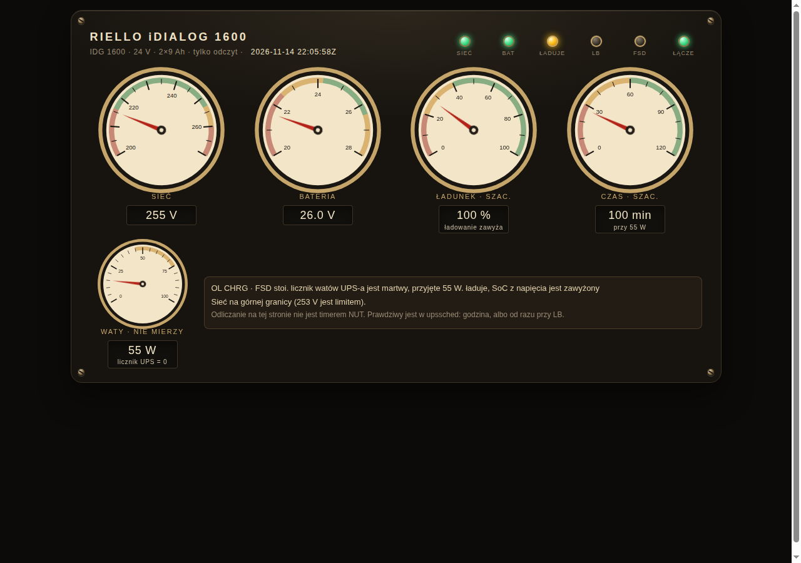

# ups-watch

Read-only [NUT](https://networkupstools.org/) watcher with a retro analog LAN panel. No CDN. The page still works when the internet does not.

Tested on a Riello iDialog IDG 1600. The firmware writes `0` into the watt field, so the watt needle is an estimate until `output.L1.realpower` or `ups.realpower` is actually above zero. A UPS that reports watts is shown as measured.



## What it does

- Polls `upsc` every 10 seconds.
- Serves `/` (the panel) and `/json`.
- Appends one CSV row per minute.
- Sends a Telegram message only on mains loss, mains return, and low battery. Silent while charging.

It does not run `upscmd`, and it does not shut the host down. That stays in `upsmon` / `upssched`. The page only displays the timer you configured. See `examples/`.

## Do not trust the charge percentage

SoC is a voltage guess for one 24 V pack (2×12 V 9 Ah). Charging voltage reads high. Runtime assumes 55 W, 70% inverter efficiency, and Peukert 1.25. Edit `soc_est` and `UPS_WATCH_WATTS` for a different pack. This is not a coulomb counter.

## Install

Needs Python 3.11+ and `upsc` on `PATH`. No third-party packages.

```bash
sudo install -m 755 ups-watch.py /usr/local/sbin/ups-watch.py
sudo install -m 600 ups-watch.env.example /etc/ups-watch.env
sudo install -m 644 ups-watch.service /etc/systemd/system/ups-watch.service
sudo install -d -m 755 /var/log/ups-watch /var/lib/ups-watch
# edit /etc/ups-watch.env, then:
sudo systemctl enable --now ups-watch
ups-watch.py --check
```

Bind `127.0.0.1` by default. Set `UPS_WATCH_BIND` to a LAN address only if you want the panel on the network. Do not put it on the internet.

| Variable | Default |
|---|---|
| `UPS_WATCH_BIND` | `127.0.0.1` |
| `UPS_WATCH_PORT` | `8420` |
| `UPS_WATCH_UPS` | `ups@localhost` |
| `UPS_WATCH_WATTS` | `55` |
| `UPS_WATCH_FSD_SEC` | `3600` |
| `TELEGRAM_BOT_TOKEN` | empty, alerts off |
| `TELEGRAM_CHAT_ID` | empty, alerts off |

`/json` fields: `status`, `model`, `vin`, `vbat`, `soc`, `minutes`, `watts`, `meter_dead`, `fsd`, `note`.

## Riello note

`riello_ser` talks GPSER at 1200 baud. On the iDialog 1600, `ups.load` and `output.L1.realpower` are zero because the UPS sends zero, not because the driver dropped the frame. `battery.runtime` is absent. The bypass fields can show as 4095 V; ignore them.
